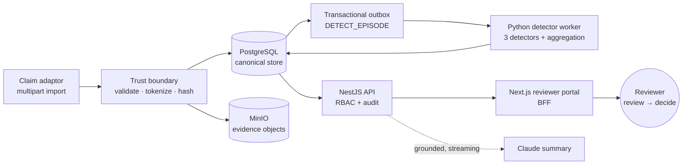

# Tilik — Sistem Integritas Bukti Pelayanan JKN

> Evidence-integrity system that detects JKN (Jaminan Kesehatan Nasional) health-claim fraud by making the
> underlying evidence **tamper-evident and traceable**. Prototype for **Healthkathon 2026**.
> **Synthetic data only — no real patient data is used anywhere in this repo.**

**🔗 Live demo: [tilik.techjuna.cloud](https://tilik.techjuna.cloud)** — walkthrough in [`DEMO.md`](DEMO.md).

Tilik ("to inspect / to scrutinise" in Javanese) is not just a fraud classifier. Its thesis is that a fraud
score is only as trustworthy as the evidence behind it — so the system is built so that **evidence cannot be
silently altered** and **every action leaves an immutable trail**. A reviewer sees not only _what_ was
flagged, but _why_, _on what evidence_, and _whether that evidence still matches what was imported_.

---

## Table of contents

- [What it does](#what-it-does)
- [How it works (data flow)](#how-it-works-data-flow)
- [The three detectors](#the-three-detectors)
- [Integrity & security model](#integrity--security-model)
- [Tech stack](#tech-stack)
- [Repository layout](#repository-layout)
- [Prerequisites](#prerequisites)
- [Quick start (local development)](#quick-start-local-development)
- [Running the services](#running-the-services)
- [Synthetic data generator](#synthetic-data-generator)
- [Testing & cross-service contracts](#testing--cross-service-contracts)
- [Production deployment & demo](#production-deployment--demo)
- [Project status & known gaps](#project-status--known-gaps)
- [License & disclaimer](#license--disclaimer)

---

## What it does

JKN fraud rarely leaves an obvious trace — it hides in **duplicate billing**, **copy-pasted clinical
narratives**, and **procedures billed without the evidence to support them**. Tilik ingests JKN claim
episodes (claims, claim lines, and their supporting evidence), runs three complementary detectors over them,
and surfaces the results to a human reviewer as **cases** ranked by severity.

Around that core, the system guarantees:

- **Tamper-evidence** — every evidence file's SHA-256 is recorded at import in an **append-only** table the
  application role cannot `UPDATE` or `DELETE`. Integrity is verified live by re-hashing the stored bytes and
  comparing against that record. Altering a file is detectable; altering the _record_ of it is impossible for
  the app.
- **No raw PII at rest** — patient identifiers are tokenized (HMAC) at the trust boundary **before** anything
  is staged. The canonical store never holds a raw patient id.
- **A complete, immutable audit trail** — `IMPORT → DETECT → VIEW_CASE → GENERATE_SUMMARY → DECIDE`, each an
  append-only ledger row.
- **Precision over noise** — detectors are tuned (and some deliberately _not_ built) so the system does not
  cry wolf. The exception cases it correctly leaves clean are a first-class part of the demo.
- **An optional, grounded AI aid** — a Claude-generated case summary that streams token-by-token, is grounded
  strictly in the on-screen evidence, renders **no verdict**, and is injection-fenced so importer-supplied
  values can't steer it.

---

## How it works (data flow)



1. **Import (the trust boundary).** `POST /v1/imports` (admin-only, multipart) runs
   **parse → validate → resolve → stage → write**. Patient tokenization and content hashing happen
   import-side, _before_ staging, so no raw patient id is ever persisted. The entire batch — staging rows,
   every episode's canonical rows, its `DETECT_EPISODE` outbox job, finalize, and the `IMPORT` audit — commits
   in **one transaction**. A failed import commits nothing (no orphaned detect jobs).
2. **Detect.** The Python worker polls the outbox, claims a job (`FOR UPDATE SKIP LOCKED`, lease-fenced),
   loads the episode under a repeatable-read snapshot, runs the three detectors, then **aggregates** findings
   into a `Case` — all in one lease-fenced transaction so a preempted worker rolls the whole group back.
3. **Review.** The NestJS API exposes read endpoints (case list / detail / evidence download with live
   integrity verification) and write endpoints (reviewer decision, grounded summary), all behind
   role-based access control with audit logging.
4. **Decide.** A reviewer adjudicates each case. The verdict is written **once** and is immutable to the app —
   the reviewer's decision is as tamper-resistant as an audit row.

The `Case` table is deliberately **two-writer**: the detector worker owns a case's _existence_ and derived
`severity`; the API/reviewer owns `status`, `assignment`, `summary`, and the `Decision`. Neither writer
touches the other's columns.

---

## The three detectors

All three are **pure functions** over an episode (plus an injected corpus and config). Each finding records
the human-readable _reasons_ behind it — no black-box scores.

| Detector               | Signal                                                                                               | Notes                                                                                                                                             |
| ---------------------- | ---------------------------------------------------------------------------------------------------- | ------------------------------------------------------------------------------------------------------------------------------------------------- |
| **REPEAT_BILLING**     | The same **non-repeatable procedure code** billed on ≥2 distinct claims, same patient, same UTC day. | Collapses claim history, drops cancelled / entered-in-error lines, and removes legitimately-repeatable **exception codes** first (no false flag). |
| **CLONING**            | Near-identical SOAP clinical narratives copied across episodes.                                      | TF-IDF cosine over word 1–3-grams; `max_df` (not idf) is what separates copied _content_ from shared template _structure_. Cross-episode corpus.  |
| **PERTENTANGAN_BUKTI** | A **surgical procedure billed with no supporting evidence** (evidence contradiction).                | Support absent + an anchor present → `HIGH` (+ a `bertentangan` evidence link). Support captured only _after_ submission → `NEEDS_MORE_INFO`.     |

**What it deliberately does _not_ flag** (precision is the product):

- Procedures with legitimately-repeatable exception codes.
- A `diagnosis → lab` rule is **intentionally not built** — it would false-positive on every
  diagnosis-without-lab episode.
- Surgical procedures _with_ timely supporting evidence — clean.

---

## Integrity & security model

- **Two-role PostgreSQL + append-only tables.** The schema owner runs migrations; the app connects as a
  **non-owner `tilik_app`** role that has no `UPDATE`/`DELETE` on append-only tables (`AuditEvent`,
  `EvidenceRecord`, `ClaimLine`, `Decision`; `ClaimVersion` is content-immutable). Enforced **both** by
  `ENABLE ALWAYS` triggers **and** by withholding the grants. Both apps/api and the Python worker assert
  `current_user = 'tilik_app'` at boot and never run migrations.
- **Evidence integrity, verified live.** On every download the API recomputes `sha256(object bytes)` and
  compares it to the append-only `contentHash` recorded at import. A mismatch logs
  `EVIDENCE_INTEGRITY_FAILED` and returns `409` **before the first byte streams**.
- **Tokenization is a pinned cross-service contract.** The import pipeline (TypeScript) and the detector
  (Python) must produce byte-identical tokens and content hashes; this is pinned by shared test vectors and
  asserted on both sides.
- **The web portal is a BFF, not a direct API client.** The JWT lives in an httpOnly cookie on the portal
  origin; a `server-only` data-access layer forwards it as a Bearer token to the API. The token never reaches
  browser JavaScript, and the web process holds no application secrets (no `JWT_SECRET`, no `ANTHROPIC_API_KEY`,
  no DB creds). A per-request nonce CSP is emitted on every response.
- **Grounded AI summary.** The summary and the case detail page share the same side-effect-free context
  gatherer, so the summary can't diverge from what's on screen. Evidence is nonce-fenced and every
  importer-influenceable value is scrubbed, so no imported value can forge a section tag or steer the model.
  The API key is server-side only and never logged.
- **Object storage hardened in prod.** MinIO is provisioned with a least-privilege IAM user (get/put only, no
  delete, never root) and an object-lock-capable (versioned) bucket.

---

## Tech stack

| Layer           | Technology                                                                     |
| --------------- | ------------------------------------------------------------------------------ |
| Reviewer portal | **Next.js 16** (App Router, BFF) · Tailwind CSS v4 · strict TypeScript         |
| API             | **NestJS 11** (CommonJS) · RBAC guard · audit interceptor · JWT                |
| Database        | **PostgreSQL** · **Prisma 7** (pg driver adapter) · two-role + append-only     |
| Detector worker | **Python 3.11** · scikit-learn (TF-IDF) · psycopg3 · pure-function detectors   |
| Object storage  | **MinIO** (S3-compatible, Chainguard mirror)                                   |
| AI summary      | **Claude** (`claude-opus-4-8`) via the official `@anthropic-ai/sdk`, streaming |
| Edge / TLS      | **Caddy** (plain VPS) or **Traefik** (Coolify)                                 |
| Orchestration   | **Docker Compose** · monorepo via **pnpm workspaces**                          |

---

## Repository layout

```
apps/web            Next.js reviewer portal (BFF: auth, dashboard, case review, decision, streaming summary, import upload)
apps/api            NestJS API (auth/RBAC/audit · import pipeline · cases read API · reviewer decision · grounded summary)
packages/shared     Shared TS enums, types, constants, and response-contract DTOs (@tilik/shared)
packages/db         Prisma 7 schema, migrations, typed client (@tilik/db)
services/detector   Python detector worker — outbox consumer (not a pnpm workspace)
data/synthetic      Deterministic, no-PII synthetic data generator (Python; not a pnpm workspace)
infra               Docker Compose (dev + prod), Caddy, Postgres init + grant SQL, env template
test-vectors        Cross-service contract fixtures (tokenization, outbox job type, audit action, narrative format)
docs                Plans, reviews, and solution write-ups (gitignored — local knowledge)
```

---

## Prerequisites

- **Node ≥ 22.18** (`.nvmrc` pins Node 22 LTS; Node 24/26 also work).
- **pnpm 10** — install directly (`npm i -g pnpm` or the standalone script). Do **not** rely on Corepack; it
  is no longer bundled in Node 25+.
- **Docker Engine + the Compose plugin** (for Postgres and MinIO).
- **Python 3.11** with [`uv`](https://docs.astral.sh/uv/) (or `venv`) — only for the detector worker and the
  synthetic data generator.
- An **Anthropic API key** with `claude-opus-4-8` enabled — only for the grounded summary feature.

---

## Quick start (local development)

Postgres + MinIO run in Docker; the app services (web / api / detector) run from your terminal.

```bash
# 1. Install JS dependencies
pnpm install

# 2. Create the single repo-root .env from the authoritative template, then edit it
cp infra/.env.example .env

# 3. Bring up the data stores (first run also creates the tilik-evidence bucket
#    and the non-owner tilik_app role). Always use the compose.sh wrapper.
cd infra
./compose.sh up -d postgres minio minio-init
./compose.sh ps          # postgres healthy · minio Up · minio-init Exited (0)
cd ..

# 4. Apply the schema, then grant the app role (re-run db:grant after EVERY migration)
pnpm --filter @tilik/db migrate:dev
pnpm --filter @tilik/db db:grant

# 5. Build the shared package and verify the workspace
pnpm --filter @tilik/shared build
pnpm build          # pnpm -r build
pnpm typecheck      # also runs the enum-parity guard in @tilik/db
pnpm lint
pnpm format:check
```

> **Why the wrapper?** `infra/compose.sh` runs `docker compose --env-file ../.env "$@"`. Compose reads its
> interpolation `.env` from its own directory, but the single source of truth is the repo-root `.env`. **Never
> create `infra/.env`** — Compose would auto-load it and silently shadow the real one.

**Environment rules that bite:**

- All services and Prisma load the **one repo-root `.env`** (gitignored — never commit real secrets).
- Only `NEXT_PUBLIC_*` variables reach the browser. Never prefix a secret with `NEXT_PUBLIC_`.
- `PATIENT_TOKEN_HMAC_KEY` keys tokenization **and** content hashes — treat it as **rotate-never** once any
  data has been imported, or the corpus de-syncs.

---

## Running the services

Each service runs independently in dev. Start Postgres + MinIO first (step 3 above).

```bash
# API (NestJS) — http://localhost:3001
pnpm --filter @tilik/api start:dev

# Web portal (Next.js) — http://localhost:3000
pnpm --filter @tilik/web dev

# Detector worker (Python) — polls the outbox
cd services/detector
uv venv .venv                                        # or: python -m venv .venv
uv pip install --python .venv -e '.[dev]'            # exact-pinned deps (or: .venv/bin/pip install -e '.[dev]')
source .venv/bin/activate
python -m detector.worker                            # watch jobs drain PENDING → PROCESSING → DONE
```

**Seed the demo** (API must be running and the `SEED_ADMIN_*` vars set): this generates a synthetic bundle and
POSTs it through the real import pipeline.

```bash
pnpm --filter @tilik/api import:seed
```

---

## Synthetic data generator

`data/synthetic` produces **byte-reproducible, no-PII** JKN episodes. Output is deterministic only for the
pinned toolchain plus `PYTHONHASHSEED=0` and a fixed `--seed`; `checksums.txt` is the cross-machine golden
file.

```bash
cd data/synthetic
uv venv .venv && source .venv/bin/activate
uv pip install -e '.[dev]'              # add [dev] for pytest
export PYTHONHASHSEED=0
python generate.py --episodes 60 --seed-fraud --seed 42   # --seed-fraud plants the fraud + exception families
```

A no-PII guard (allow-list Faker facade + a pre-write digit scan) fails the run on any plausibly-real
identifier.

---

## Testing & cross-service contracts

The TypeScript import pipeline and the Python detector must agree byte-for-byte. Those agreements are pinned
by fixtures in `test-vectors/` and asserted on both sides:

```bash
pnpm --filter @tilik/api test:vectors     # tokenization vectors (TS side)
pnpm --filter @tilik/api test:contract    # outbox job-type contract (TS side)

cd services/detector && PYTHONHASHSEED=0 python -m pytest tests/   # detector unit + contract tests
cd data/synthetic    && PYTHONHASHSEED=0 python -m pytest tests/   # generator determinism + no-PII guard
```

> Detector DB-integration tests require an **isolated** database (`DETECTOR_TEST_DATABASE_URL`) or they skip —
> never run them against a dirty outbox.

---

## Production deployment & demo

The reference deployment is live at **[tilik.techjuna.cloud](https://tilik.techjuna.cloud)** (full stack
behind Caddy with a Let's Encrypt cert).

- **[`DEPLOY.md`](DEPLOY.md)** — full production runbook: `infra/docker-compose.prod.yml` behind Caddy (TLS),
  one-shot migrate + grant on deploy, a one-command idempotent synthetic seed, a Go/No-Go verification
  checklist, storage hardening, backup/restore, troubleshooting, and a Coolify path.

  ```bash
  cd infra
  ./compose.sh -f docker-compose.prod.yml up -d --build
  ./compose.sh -f docker-compose.prod.yml --profile seed run --rm seed
  ```

- **[`DEMO.md`](DEMO.md)** — a repeatable 5–7 minute walkthrough of the evidence-integrity story: fraud
  detected, evidence tamper-evident, nothing over-flagged, a grounded AI summary, an immutable decision, and a
  complete audit trail.

---

## Project status & known gaps

This is a **complete, working Healthkathon 2026 prototype** — all three detectors, the full import → detect →
review → decide → summarize flow, tamper-evident storage, RBAC, and an immutable audit trail are implemented
and deployable. In the spirit of honesty:

- **Synthetic data only.** No real patient data is used; the whole pipeline is designed around that constraint.
- **Seeded fraud cases are payload-backed**, so the verified-file-download + 409-on-tamper path isn't
  reachable from the seeded UI (file-backed evidence sits on the clean episodes). The code path exists and is
  exercised by those clean episodes — it's a seed-data limitation, not a missing feature.
- **No segregation of duties.** The same actor can import and decide; this is intentionally left as an
  audit-detectable gap rather than a hard block for the prototype.

---

## License & disclaimer

Prototype built for **Healthkathon 2026**. **Synthetic data only** — this repository contains no real patient,
provider, or claim data, and must not be pointed at production JKN data without a full privacy and security
review.
